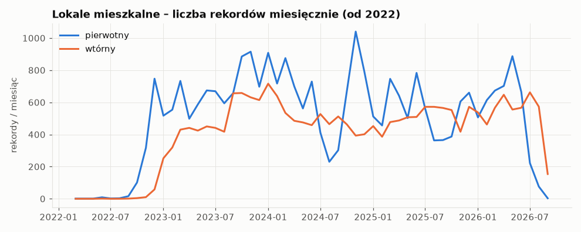
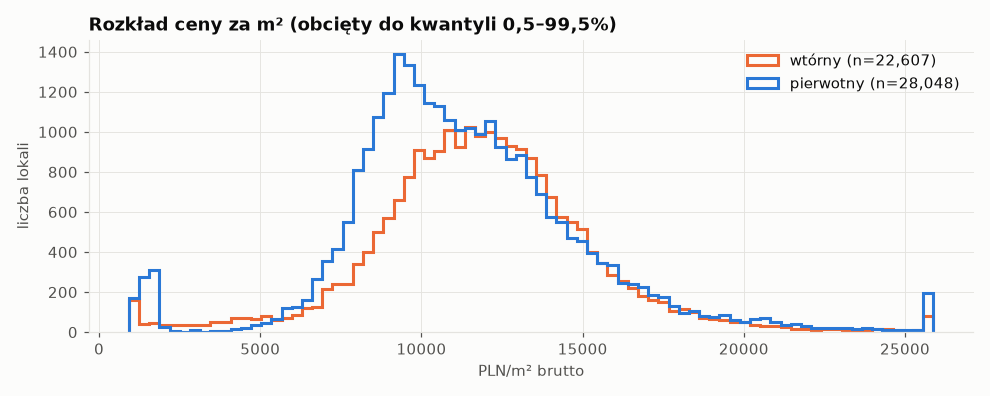
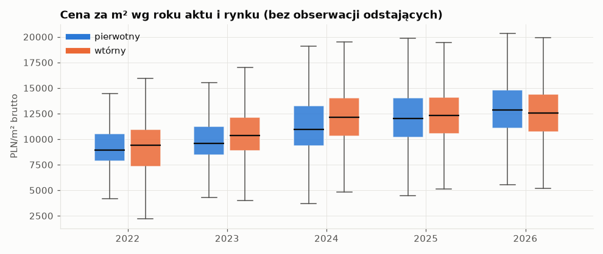
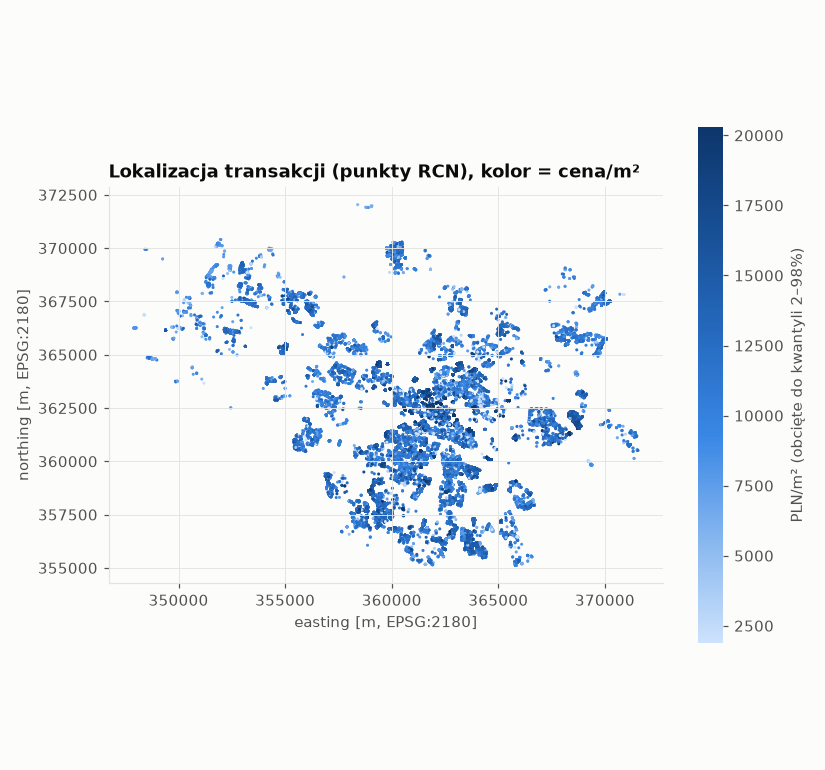

# RCN Wrocław – raport eksploracyjny (lokale)

Wygenerowano: 2026-11-12 22:53. Wejście: `data/interim/rcn_lokale_raw.parquet`.

Źródło: WFS GUGiK `ms:lokale`, filtr `TERYT == 0264`, deduplikacja po `gid`. Pole `dok_tworca` (dane notariuszy) pominięte przy parsowaniu. Na tym etapie **nic nie jest odrzucane** – to opis surowych danych.

## 1. Liczba rekordów

- Wszystkie lokale (każda funkcja): **62,470**
- Lokale mieszkalne: **50,818**
- Transakcje (unikalne `tran_lokalny_id_iip`) z ≥1 lokalem mieszkalnym: **50,730**

### Funkcja lokalu (wszystkie rekordy)

| lok_funkcja      |   liczba |    % |
|:-----------------|---------:|-----:|
| mieszkalna       |    50818 | 81.3 |
| garaz            |     7542 | 12.1 |
| inna             |     3861 |  6.2 |
| handlowoUslugowa |      204 |  0.3 |
| biurowa          |       40 |  0.1 |
| produkcyjna      |        3 |  0   |
| <brak>           |        2 |  0   |

### Rodzaj transakcji (lokale mieszkalne)

| tran_rodzaj_trans                 |   liczba |    % |
|:----------------------------------|---------:|-----:|
| wolnyRynek                        |    47703 | 93.9 |
| sprzedazBezprzetargowa            |     1968 |  3.9 |
| sprzedazZBonifikata               |      857 |  1.7 |
| sprzedazPrzetargowa               |      275 |  0.5 |
| sprzedazWPostepowaniuEgzekucyjnym |        9 |  0   |
| sprzedazNaCelPubliczny            |        6 |  0   |

### Rodzaj rynku (lokale mieszkalne)

| tran_rodzaj_rynku   |   liczba |    % |
|:--------------------|---------:|-----:|
| rynekPierwotny      |    28091 | 55.3 |
| rynekWtorny         |    22695 | 44.7 |
| <brak>              |       32 |  0.1 |

### Sprzedający (lokale mieszkalne)

| tran_sprzedajacy                 |   liczba |    % |
|:---------------------------------|---------:|-----:|
| osobaPrawna                      |    26050 | 51.3 |
| osobaFizyczna                    |    21709 | 42.7 |
| jednostkaSamorzaduTerytorialnego |     3017 |  5.9 |
| skarbPanstwa                     |       42 |  0.1 |

### Kupujący (lokale mieszkalne)

| tran_kupujacy                    |   liczba |    % |
|:---------------------------------|---------:|-----:|
| osobaFizyczna                    |    48917 | 96.3 |
| osobaPrawna                      |     1838 |  3.6 |
| jednostkaSamorzaduTerytorialnego |       60 |  0.1 |
| skarbPanstwa                     |        3 |  0   |

### Rodzaj nieruchomości (lokale mieszkalne)

| nier_rodzaj          |   liczba |   % |
|:---------------------|---------:|----:|
| nieruchomoscLokalowa |    50818 | 100 |

### Prawo (lokale mieszkalne)

| nier_prawo                         |   liczba |   % |
|:-----------------------------------|---------:|----:|
| wlasnoscLokaluWrazZPrawemZwiazanym |    50814 | 100 |
| <brak>                             |        2 |   0 |
| wlasnoscNieruchomosciGruntowej     |        2 |   0 |

## 2. Zakres dat (`dok_data`, lokale mieszkalne)

- Najstarsza: **1982-06-02**, najnowsza: **2026-09-28**, braki: 1

|        |   1982 |   1990 |   1995 |   1996 |   1999 |   2001 |   2002 |   2003 |   2004 |   2005 |   2007 |   2008 |   2009 |   2010 |   2012 |   2013 |   2014 |   2015 |   2016 |   2017 |   2018 |   2019 |   2020 |   2021 |   2022 |   2023 |   2024 |   2025 |   2026 |
|:-------|-------:|-------:|-------:|-------:|-------:|-------:|-------:|-------:|-------:|-------:|-------:|-------:|-------:|-------:|-------:|-------:|-------:|-------:|-------:|-------:|-------:|-------:|-------:|-------:|-------:|-------:|-------:|-------:|-------:|
| liczba |      1 |      1 |      1 |      1 |      3 |      4 |      3 |      3 |      2 |      1 |      4 |      2 |      4 |      5 |      6 |      5 |      5 |      7 |      6 |     11 |      8 |      6 |      9 |     17 |   1271 |  13713 |  14000 |  12649 |   9069 |

- `tran_wersja_id` (wersja wpisu w RCN): 1990-01-01 … 2026-10-16

## 3. Profil pól (lokale mieszkalne)

| pole                  | typ                 |   % braków |   unikalne | przykłady / zakres                                                                                                           |
|:----------------------|:--------------------|-----------:|-----------:|:-----------------------------------------------------------------------------------------------------------------------------|
| gid                   | Int64               |        0   |      50818 | (identyfikator)                                                                                                              |
| serwis_rcn            | string              |      100   |          0 |                                                                                                                              |
| teryt                 | string              |        0   |          1 | 0264                                                                                                                         |
| tran_przestrzen_nazw  | string              |        0   |          1 | PL.PZGiK.4611.RCN                                                                                                            |
| tran_lokalny_id_iip   | string              |        0   |      50730 | (identyfikator)                                                                                                              |
| tran_wersja_id        | datetime64[us, UTC] |        0   |      50625 | 1990-01-01 00:00:00+00:00 … 2026-10-16 14:43:49+00:00                                                                        |
| tran_oznaczenie_trans | string              |        0   |      50730 | (identyfikator)                                                                                                              |
| tran_rodzaj_trans     | string              |        0   |          6 | wolnyRynek; sprzedazBezprzetargowa; sprzedazZBonifikata                                                                      |
| tran_rodzaj_rynku     | string              |        0.1 |          2 | rynekPierwotny; rynekWtorny                                                                                                  |
| tran_sprzedajacy      | string              |        0   |          4 | osobaPrawna; osobaFizyczna; jednostkaSamorzaduTerytorialnego                                                                 |
| tran_kupujacy         | string              |        0   |          4 | osobaFizyczna; osobaPrawna; jednostkaSamorzaduTerytorialnego                                                                 |
| tran_cena_brutto      | Float64             |        0   |      25041 | min 1.00 / med 577,262.00 / max 98,021,407,904.00                                                                            |
| tran_vat              | Float64             |       99.8 |          1 | min 8.00 / med 8.00 / max 8.00                                                                                               |
| dok_oznaczenie        | string              |        0   |      34256 | Rep. A 180/2023; Rep. A 996/2023; Rep. A 1/2025                                                                              |
| dok_data              | datetime64[us]      |        0   |       1284 | 1982-06-02 00:00:00 … 2026-09-28 00:00:00                                                                                    |
| nier_rodzaj           | string              |        0   |          1 | nieruchomoscLokalowa                                                                                                         |
| nier_prawo            | string              |        0   |          2 | wlasnoscLokaluWrazZPrawemZwiazanym; wlasnoscNieruchomosciGruntowej                                                           |
| nier_udzial           | string              |        0   |        238 | 1/1; 1/2; 1/6                                                                                                                |
| nier_pow_gruntu       | Float64             |      100   |          0 |                                                                                                                              |
| nier_opis             | string              |       97.3 |        890 | + prawo do wyłącznego korzystania z miej; + prawo do wyłącznego korzystania z miej; po zastosowaniu bonifikaty w wysokości 8 |
| nier_cena_brutto      | Float64             |        3.5 |      24044 | min 1.00 / med 579,958.94 / max 54,121,011.00                                                                                |
| nier_vat              | Float64             |      100   |          0 |                                                                                                                              |
| lok_id_lokalu         | string              |        0   |      47814 | (identyfikator)                                                                                                              |
| lok_funkcja           | string              |        0   |          1 | mieszkalna                                                                                                                   |
| lok_liczba_izb        | Int64               |        0.4 |         15 | min 1.00 / med 3.00 / max 57.00                                                                                              |
| lok_nr_kond           | Int64               |        0.6 |         39 | min -1.00 / med 3.00 / max 48.00                                                                                             |
| lok_pow_uzyt          | Float64             |        0   |       8716 | min 3.29 / med 50.58 / max 8,447.99                                                                                          |
| lok_pow_przyn         | Float64             |       79   |       1362 | min 0.40 / med 3.43 / max 1,385.00                                                                                           |
| lok_cena_brutto       | Float64             |       11.4 |      21428 | min 0.00 / med 574,860.66 / max 520,980,705.00                                                                               |
| lok_vat               | Float64             |      100   |          0 |                                                                                                                              |
| lok_info              | string              |       94.9 |        538 | brutto; prawo wyłącznego korzystania z miejsca p; - prawo do korzystania z miejsca postojo                                   |
| lok_adres             | string              |        0.3 |      13995 | MSC:Wrocław;UL:gen. Władysława Sikorskie; MSC:Wrocław;UL:Czysta;NR_PORZ:4; MSC:Wrocław;UL:Jedności Narodowej;NR_POR          |

## 4. Transakcje wielolokalowe i udziały

Liczba rekordów `ms:lokale` w transakcji, do której należy lokal mieszkalny (10 = 10 i więcej):

|   n_units_in_trans |   liczba |    % |
|-------------------:|---------:|-----:|
|                  1 |    48874 | 96.2 |
|                  2 |     1857 |  3.7 |
|                  3 |       47 |  0.1 |
|                  5 |       14 |  0   |
|                  6 |       11 |  0   |
|                 10 |       10 |  0   |
|                  4 |        5 |  0   |

Liczba **lokali mieszkalnych** w tej samej transakcji:

|   n_flats_in_trans |   liczba |    % |
|-------------------:|---------:|-----:|
|                  1 |    50670 | 99.7 |
|                  2 |      100 |  0.2 |
|                  5 |       15 |  0   |
|                 10 |       10 |  0   |
|                  3 |        9 |  0   |
|                  4 |        8 |  0   |
|                  6 |        6 |  0   |

Udział (`nier_udzial`) – 10 najczęstszych wartości:

| nier_udzial   |   liczba |    % |
|:--------------|---------:|-----:|
| 1/1           |    49872 | 98.1 |
| 1/2           |      425 |  0.8 |
| 1/6           |       40 |  0.1 |
| 1/3           |       39 |  0.1 |
| 1/4           |       36 |  0.1 |
| 2/3           |       17 |  0   |
| 3/4           |       17 |  0   |
| 1/10          |       15 |  0   |
| 1/8           |       13 |  0   |
| 2/5           |       10 |  0   |

- `tran_oznaczenie_trans` = `tran_lokalny_id_iip` (bez myślników): 100.0% rekordów.

## 5. Spójność cen

- Lokale mieszkalne z wypełnionym `lok_cena_brutto`: 88.6%
- Transakcje jednolokalowe: 48,874; z obiema cenami: 43,222; w tym `lok_cena == tran_cena`: 95.2%
- `tran_vat` wypełniony: 0.2%; `lok_vat`: 0.0%
- `lok_info` – najczęstsze wartości:

| lok_info                                                                                  |   liczba |    % |
|:------------------------------------------------------------------------------------------|---------:|-----:|
| <brak>                                                                                    |    48238 | 94.9 |
| brutto                                                                                    |      724 |  1.4 |
| prawo wyłącznego korzystania z miejsca postojowego                                        |      167 |  0.3 |
| - prawo do korzystania z miejsca postojowego podziemnego                                  |      156 |  0.3 |
| prawo wyłącznego korzystania z miejsca postojowego i komórki lokatorskiej                 |      104 |  0.2 |
| brak informacji brutto/netto                                                              |       82 |  0.2 |
| -prawo do wyłącznego korzystania z zewnętrznego miejsca postojowego                       |       74 |  0.1 |
| lokal z balkonem                                                                          |       72 |  0.1 |
| - prawo wyłącznego korzystania z miejsca garażowego podziemnego oraz komórki lokatorskiej |       62 |  0.1 |
| cena brutto                                                                               |       49 |  0.1 |

## 6. Cena za m²

`price_m2 = lok_cena_brutto / lok_pow_uzyt`; gdy brak ceny lokalu – `tran_cena_brutto / lok_pow_uzyt`, ale tylko dla transakcji jednolokalowych.

| price_m2_source   |   liczba |    % |
|:------------------|---------:|-----:|
| lok               |    45031 | 88.6 |
| tran              |     5652 | 11.1 |
| <brak>            |      135 |  0.3 |

Kwantyle (PLN/m² brutto):

|      |   wszystkie |   pierwotny |    wtórny |
|:-----|------------:|------------:|----------:|
| q00  |           0 |           0 |         0 |
| q01  |       1,460 |       1,434 |     1,783 |
| q05  |       6,553 |       6,602 |     6,547 |
| q25  |       9,427 |       9,144 |     9,927 |
| q50  |      11,375 |      10,958 |    11,811 |
| q75  |      13,491 |      13,246 |    13,734 |
| q95  |      17,493 |      17,594 |    17,393 |
| q99  |      22,867 |      23,431 |    22,016 |
| q100 |   9,124,005 |     186,494 | 9,124,005 |

Rodzaj transakcji × rynek (lokale mieszkalne):

| tran_rodzaj_trans                 |   <brak> |   rynekPierwotny |   rynekWtorny |
|:----------------------------------|---------:|-----------------:|--------------:|
| sprzedazBezprzetargowa            |        5 |             1954 |             9 |
| sprzedazNaCelPubliczny            |        0 |                0 |             6 |
| sprzedazPrzetargowa               |        0 |              259 |            16 |
| sprzedazWPostepowaniuEgzekucyjnym |        0 |                0 |             9 |
| sprzedazZBonifikata               |        0 |              842 |            15 |
| wolnyRynek                        |       27 |            25036 |         22640 |

Cena/m² wg rodzaju transakcji:

| tran_rodzaj_trans                 |     n |   q05 |   mediana |    q95 |
|:----------------------------------|------:|------:|----------:|-------:|
| wolnyRynek                        | 47568 | 7,103 |    11,587 | 17,640 |
| sprzedazBezprzetargowa            |  1968 | 6,371 |     8,810 | 11,258 |
| sprzedazZBonifikata               |   857 |   797 |     1,616 | 11,342 |
| sprzedazPrzetargowa               |   275 | 6,122 |     9,112 | 15,683 |
| sprzedazWPostepowaniuEgzekucyjnym |     9 | 1,730 |     8,883 | 20,225 |
| sprzedazNaCelPubliczny            |     6 | 9,685 |    10,633 | 11,667 |

Cena/m² wg sprzedającego:

| tran_sprzedajacy                 |     n |   mediana |
|:---------------------------------|------:|----------:|
| osobaPrawna                      | 26000 |    11,453 |
| osobaFizyczna                    | 21624 |    11,738 |
| jednostkaSamorzaduTerytorialnego |  3017 |     8,400 |
| skarbPanstwa                     |    42 |     7,549 |

- `price_m2` < 1,000 PLN/m² (cena symboliczna?): **268**
- `price_m2` > 50,000 PLN/m²: **17**
- Brak `price_m2`: **135**

Mediana ceny/m² i liczba wg roku:

|   rok |   median_pierwotny |   median_wtórny |   count_pierwotny |   count_wtórny |
|------:|-------------------:|----------------:|------------------:|---------------:|
|  2015 |              5,014 |           5,433 |                 1 |              3 |
|  2016 |              5,496 |           6,761 |                 3 |              2 |
|  2017 |              5,937 |             nan |                 8 |            nan |
|  2018 |              8,124 |           6,044 |                 4 |              1 |
|  2019 |              6,027 |             nan |                 5 |            nan |
|  2020 |              5,857 |           7,631 |                 8 |              1 |
|  2021 |              6,730 |           2,474 |                16 |              1 |
|  2022 |              8,948 |           9,430 |             1,194 |             73 |
|  2023 |              9,562 |          10,374 |             7,953 |          5,711 |
|  2024 |             10,937 |          12,126 |             7,932 |          6,051 |
|  2025 |             11,989 |          12,291 |             6,569 |          6,042 |
|  2026 |             12,835 |          12,579 |             4,347 |          4,699 |

## 7. Cechy lokalu

- `lok_pow_uzyt`: braki 0.0%, q01=24.1, mediana=50.6, q99=145.1, max=8448.0
- `lok_liczba_izb`: braki 0.4%, q01=1.0, mediana=3.0, q99=5.0, max=57.0
- `lok_nr_kond`: braki 0.6%, q01=1.0, mediana=3.0, q99=11.0, max=48.0
- `lok_pow_przyn`: braki 79.0%, q01=1.1, mediana=3.4, q99=35.6, max=1385.0

## 8. Geolokalizacja

- Rekordy z punktem: 100.00% (50,818)
- Unikalne punkty: 9,382 → średnio 5.4 lokalu na punkt (punkt = najpewniej budynek)
- Unikalne identyfikatory budynków (prefiks `lok_id_lokalu` do `_BUD`): 9,720
- Zasięg (EPSG:2180, E/N): E 347,899–371,541, N 355,120–372,041

