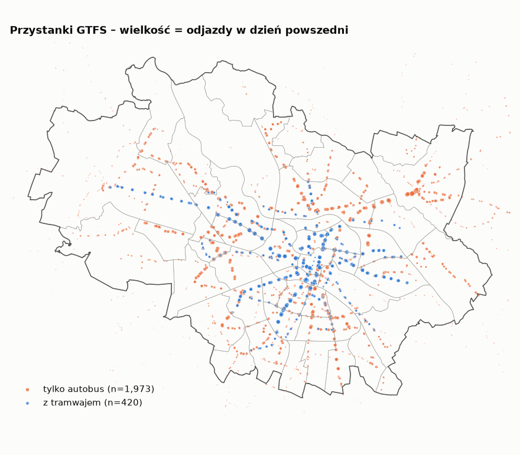
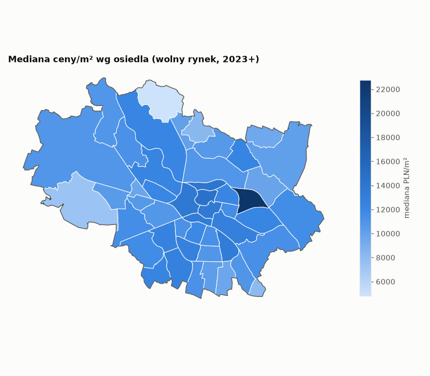

# Etap 2 – dane kontekstowe: granice, komunikacja, POI

Wygenerowano: 2026-11-12 23:09.

## 1. Granice

- Granica miasta (PRG, warstwa `ms:powiaty` usługi RCN): **292.5 km²**
- Osiedla: **48** (uchwała XX/419/16); różnica sumy osiedli i granicy miasta: 0.002 km²
- Lokale mieszkalne RCN wewnątrz granicy miasta: **100.00%** (0 poza)

## 2. Komunikacja – GTFS

- Okres ważności rozkładu: 2025-11-24 – 2025-12-12; dzień reprezentatywny: 2025-11-26 (Wednesday)
- Słupki przystankowe: 2,429 (w granicach miasta: 1,887); bez odjazdów w tym dniu: 36
- Słupki z tramwajem: 420; unikalne nazwy przystanków: 987

Rozkład wskaźników na słupek (w granicach miasta):

|                 |   count |   mean |   std |   min |   25% |   50% |   75% |   95% |   max |
|:----------------|--------:|-------:|------:|------:|------:|------:|------:|------:|------:|
| n_lines         |    1887 |    4.9 |   4.8 |     0 |   2   |     4 |     6 |    16 |    44 |
| n_lines_tram    |    1887 |    1   |   2.6 |     0 |   0   |     0 |     0 |     5 |    19 |
| n_lines_bus_day |    1887 |    3   |   4   |     0 |   0   |     2 |     4 |    10 |    31 |
| dep_day         |    1887 |  164.6 | 126.8 |     0 |  65.5 |   149 |   241 |   422 |   786 |
| dep_peak_7_9    |    1887 |   19.4 |  15.3 |     0 |   8   |    17 |    29 |    50 |   109 |

## 3. POI z OpenStreetMap

Snapshot Overpass: 2026-11-12; obszar = granica miasta + 2 km bufora.

| category      | typ   |   razem |   w_miescie |   możliwe duplikaty | definicja                                               |
|:--------------|:------|--------:|------------:|--------------------:|:--------------------------------------------------------|
| forest        | area  |    2986 |        2284 |                   0 | landuse=forest, natural=wood                            |
| food_drink    | point |    1855 |        1756 |                  12 | amenity=restaurant|cafe|fast_food|bar|pub               |
| playground    | point |    1831 |        1693 |                   2 | leisure=playground                                      |
| railway_line  | line  |    1721 |        1663 |                   0 | railway=rail                                            |
| water         | area  |    1353 |         809 |                   0 | natural=water                                           |
| major_road    | line  |    1077 |         733 |                   0 | highway=motorway|trunk|primary                          |
| parcel_locker | point |    1038 |         948 |                   0 | amenity=parcel_locker                                   |
| industrial    | area  |     840 |         607 |                   0 | landuse=industrial                                      |
| convenience   | point |     821 |         760 |                  54 | shop=convenience                                        |
| school        | point |     398 |         376 |                   0 | amenity=school                                          |
| kindergarten  | point |     370 |         336 |                   2 | amenity=kindergarten (excluding names with 'żłob')      |
| clinic        | point |     361 |         346 |                   6 | amenity=clinic|doctors, healthcare=clinic|centre|doctor |
| park          | area  |     354 |         327 |                   0 | leisure=park                                            |
| sport         | point |     260 |         224 |                   2 | leisure=sports_centre|fitness_centre|swimming_pool      |
| pharmacy      | point |     254 |         240 |                   0 | amenity=pharmacy                                        |
| university    | point |     231 |         231 |                   5 | amenity=university|college                              |
| supermarket   | point |     224 |         194 |                   0 | shop=supermarket                                        |
| culture       | point |     112 |         104 |                   2 | amenity=theatre|cinema|library|arts_centre              |
| post_office   | point |      93 |          87 |                   0 | amenity=post_office                                     |
| nursery       | point |      59 |          50 |                   0 | żłobek: amenity=childcare or kindergarten named 'żłob…' |
| cemetery      | area  |      52 |          39 |                   0 | landuse=cemetery                                        |
| rail_station  | point |      38 |          30 |                   0 | railway=station|halt (train)                            |
| mall          | point |      32 |          29 |                   0 | shop=mall                                               |
| hospital      | point |      16 |          16 |                   0 | amenity=hospital                                        |

*Możliwe duplikaty* = obiekty punktowe, które mają obiekt tej samej kategorii i nazwy w promieniu 100 m (np. węzeł + obrys budynku). Do rozstrzygnięcia przy liczeniu cech.

## 4. RCN wg osiedli

Filtr roboczy (tylko na potrzeby opisu): wolny rynek, akt od 2023, cena/m² w przedziale 3–50 tys. zł.

Najdroższe i najtańsze osiedla (mediana PLN/m²):

| osiedle                                        |    n |   median_price_m2 |
|:-----------------------------------------------|-----:|------------------:|
| Zacisze - Zalesie - Szczytniki                 |  151 |            22,764 |
| Nadodrze                                       | 2250 |            14,576 |
| Kleczków                                       |  573 |            14,187 |
| Szczepin                                       | 3042 |            13,783 |
| Stare Miasto                                   |  759 |            13,565 |
| Pawłowice                                      |   30 |             9,468 |
| Widawa                                         |   73 |             8,304 |
| Bieńkowice                                     |   17 |             8,124 |
| Jerzmanowo - Jarnołtów - Strachowice - Osiniec |   17 |             7,347 |
| Świniary                                       |   20 |             4,804 |

- Osiedla z < 30 transakcjami: 3; bez transakcji: 0

## 5. Kompletność RCN vs GUS BDL

**Brak danych GUS** – API BDL zwróciło limit zapytań. Uruchom `uv run rcn fetch-gus` (opcjonalnie z `BDL_CLIENT_ID`) i wygeneruj raport ponownie.

### RCN – rynek wg roku (dla porównania)

| tran_rodzaj_rynku   |   liczba |    % |
|:--------------------|---------:|-----:|
| rynekPierwotny      |    28091 | 55.3 |
| rynekWtorny         |    22695 | 44.7 |
| <brak>              |       32 |  0.1 |
