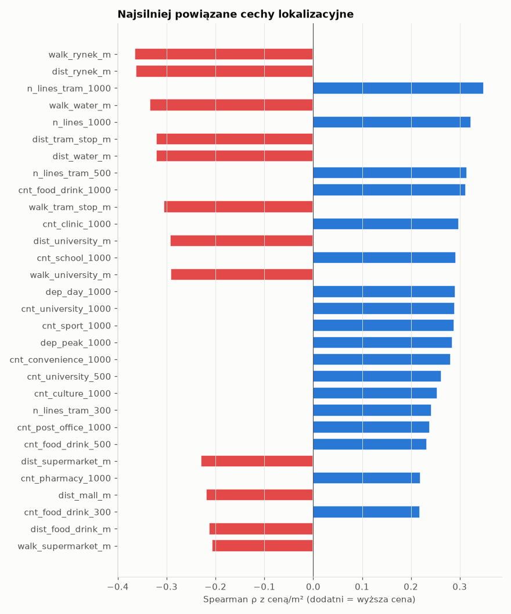
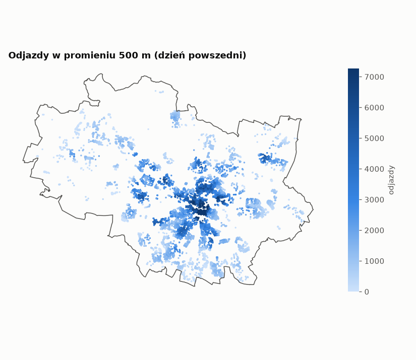
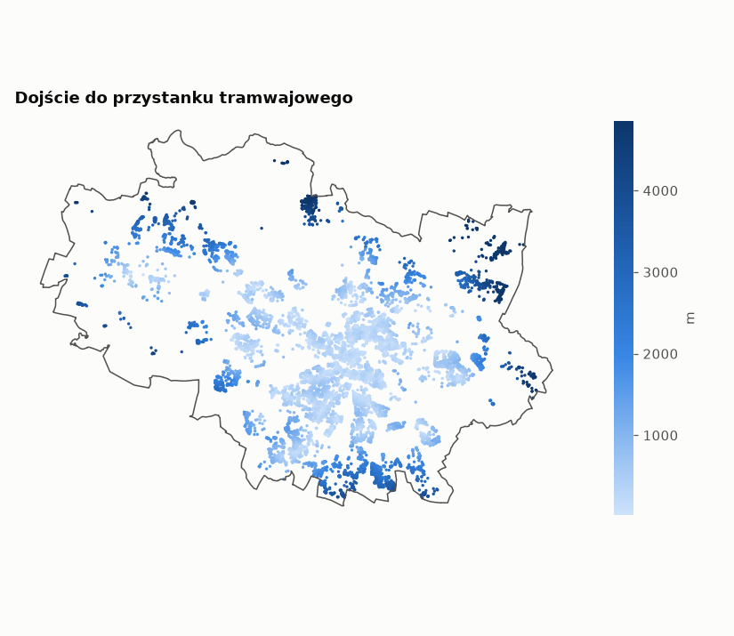
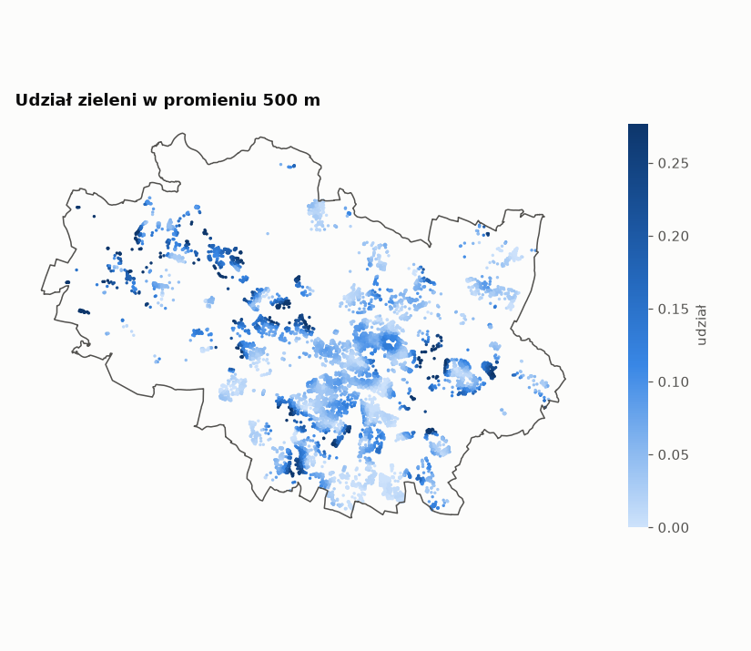

# Etap 3 – cechy lokalizacyjne

Wygenerowano: 2026-11-12 23:38. Plik: `data/processed/location_features.parquet`.

- Unikalne lokalizacje (punkty RCN): **9,910**; cechy liczbowe: **114** + `osiedle`
- Braki: 0 wartości; lokalizacje bez osiedla: 0
- Próba robocza do korelacji: 45,188 transakcji (wolny rynek, 1 lokal, udział 1/1, akt od 2023, 3–50 tys. zł/m²) – **to nie jest jeszcze docelowe czyszczenie**.

## 1. Słownik cech

| grupa        | cechy                                                   | opis                                                 |
|:-------------|:--------------------------------------------------------|:-----------------------------------------------------|
| Lokalizacja  | osiedle                                                 | osiedle (48, uchwała 2016); kategoria                |
| Lokalizacja  | x_2180, y_2180                                          | współrzędne punktu (EPSG:2180)                       |
| Centrum      | dist_rynek_m, walk_rynek_m                              | odległość do Rynku: prosta / piesza                  |
| Centrum      | dir_rynek_sin/cos                                       | kierunek od Rynku (azymut jako sin/cos)              |
| Komunikacja  | dist_stop_m, walk_stop_m                                | najbliższy obsługiwany słupek (prosta / pieszo)      |
| Komunikacja  | dist_tram_stop_m, walk_tram_stop_m                      | najbliższy przystanek tramwajowy                     |
| Komunikacja  | n_lines_{r}, n_lines_tram_{r}                           | liczba różnych linii w promieniu r                   |
| Komunikacja  | dep_day_{r}, dep_peak_{r}                               | odjazdy w dzień powszedni / 7–9 w promieniu r        |
| POI punktowe | dist_<kat>_m                                            | odległość do najbliższego obiektu kategorii          |
| POI punktowe | cnt_<kat>_{300,500,1000}                                | liczba obiektów kategorii w promieniu                |
| POI punktowe | walk_<kat>_m                                            | odległość piesza (wybrane kategorie)                 |
| Tereny       | dist_park_m / forest / water                            | do parku ≥0,5 ha / lasu ≥1 ha / wody ≥1 ha           |
| Tereny       | walk_park_m / forest / water                            | pieszo do węzła sieci ≤30 m od terenu                |
| Tereny       | share_green_{500,1000}                                  | udział parków+lasów w buforze                        |
| Uciążliwości | dist_industrial_m, share_industrial_500                 | teren przemysłowy                                    |
| Uciążliwości | dist_major_road_m, dist_railway_line_m, dist_cemetery_m | drogi, kolej                                         |
| Sieć         | walk_snap_m                                             | odległość punktu od najbliższego węzła sieci pieszej |

Promienie r = 300 / 500 / 1000 m. Odległości piesze liczone po grafie OSM `walk` (OSMnx), ograniczone do 5 km.

## 2. Rozkłady

|                        |        5% |       50% |       95% |       max |   % zer |
|:-----------------------|----------:|----------:|----------:|----------:|--------:|
| dist_rynek_m           |     886.4 |   3,745.6 |  10,283.4 |  15,873.8 |     0.0 |
| dir_rynek_sin          |      -1.0 |      -0.0 |       1.0 |       1.0 |     0.0 |
| dir_rynek_cos          |      -1.0 |      -0.0 |       1.0 |       1.0 |     0.0 |
| dist_stop_m            |      37.7 |     155.6 |     431.5 |   1,020.1 |     0.0 |
| dist_tram_stop_m       |      62.7 |     318.9 |   3,019.2 |   6,154.1 |     0.0 |
| n_lines_300            |       0.0 |       7.0 |      22.0 |      45.0 |    14.3 |
| n_lines_tram_300       |       0.0 |       0.0 |       8.0 |      16.0 |    52.1 |
| dep_day_300            |       0.0 |     709.0 |   2,834.2 |   4,976.0 |    14.3 |
| dep_peak_300           |       0.0 |      86.0 |     343.0 |     603.0 |    14.3 |
| n_lines_500            |       1.0 |      11.0 |      34.0 |      53.0 |     2.9 |
| n_lines_tram_500       |       0.0 |       2.0 |      12.0 |      19.0 |    38.9 |
| dep_day_500            |      96.0 |   1,860.0 |   5,868.6 |  12,061.0 |     2.9 |
| dep_peak_500           |      11.0 |     223.0 |     709.0 |   1,405.0 |     2.9 |
| n_lines_1000           |       5.0 |      23.0 |      57.0 |      65.0 |     0.0 |
| n_lines_tram_1000      |       0.0 |       5.0 |      19.0 |      22.0 |    28.0 |
| dep_day_1000           |   1,076.0 |   7,746.5 |  21,038.4 |  28,272.0 |     0.0 |
| dep_peak_1000          |     121.5 |     935.0 |   2,541.7 |   3,360.0 |     0.0 |
| dist_cemetery_m        |     287.4 |   1,213.4 |   2,328.6 |   3,256.5 |     0.0 |
| dist_clinic_m          |      58.5 |     265.7 |     984.4 |   4,056.8 |     0.0 |
| cnt_clinic_300         |       0.0 |       1.0 |       5.0 |      13.0 |    44.7 |
| cnt_clinic_500         |       0.0 |       2.0 |      11.0 |      23.0 |    23.8 |
| cnt_clinic_1000        |       1.0 |       8.0 |      38.0 |      52.0 |     4.8 |
| dist_convenience_m     |      28.9 |     136.1 |     624.6 |   2,729.0 |     0.0 |
| cnt_convenience_300    |       0.0 |       3.0 |      10.0 |      20.0 |    17.6 |
| cnt_convenience_500    |       0.0 |       6.0 |      22.0 |      30.0 |     7.7 |
| cnt_convenience_1000   |       2.0 |      18.0 |      65.0 |      77.0 |     2.3 |
| dist_culture_m         |      98.6 |     544.1 |   2,085.8 |   3,562.6 |     0.0 |
| cnt_culture_300        |       0.0 |       0.0 |       3.0 |      10.0 |    73.2 |
| cnt_culture_500        |       0.0 |       0.0 |       8.0 |      14.0 |    53.9 |
| cnt_culture_1000       |       0.0 |       2.0 |      21.0 |      33.0 |    23.3 |
| dist_food_drink_m      |      20.4 |     150.9 |     641.0 |   2,744.6 |     0.0 |
| cnt_food_drink_300     |       0.0 |       3.0 |      30.0 |     232.0 |    21.9 |
| cnt_food_drink_500     |       0.0 |       8.0 |      82.0 |     382.0 |     8.8 |
| cnt_food_drink_1000    |       2.0 |      28.0 |     412.0 |     614.0 |     1.6 |
| dist_forest_m          |     102.1 |     664.9 |   1,694.1 |   2,348.2 |     0.0 |
| dist_hospital_m        |     327.0 |   1,510.7 |   4,203.6 |   6,946.2 |     0.0 |
| cnt_hospital_300       |       0.0 |       0.0 |       0.0 |       2.0 |    96.0 |
| cnt_hospital_500       |       0.0 |       0.0 |       1.0 |       3.0 |    88.6 |
| cnt_hospital_1000      |       0.0 |       0.0 |       2.0 |       4.0 |    69.9 |
| dist_industrial_m      |      69.6 |     296.6 |     656.7 |   1,383.3 |     0.1 |
| dist_kindergarten_m    |      66.9 |     242.1 |     662.5 |   3,253.9 |     0.0 |
| cnt_kindergarten_300   |       0.0 |       1.0 |       3.0 |       6.0 |    36.9 |
| cnt_kindergarten_500   |       0.0 |       2.0 |       6.0 |      12.0 |    12.1 |
| cnt_kindergarten_1000  |       2.0 |       8.0 |      19.0 |      29.0 |     1.7 |
| dist_major_road_m      |     160.2 |   1,745.7 |   3,685.9 |   4,918.3 |     0.0 |
| dist_mall_m            |     262.6 |   1,024.1 |   3,818.3 |   8,344.0 |     0.0 |
| cnt_mall_300           |       0.0 |       0.0 |       1.0 |       3.0 |    93.4 |
| cnt_mall_500           |       0.0 |       0.0 |       1.0 |       3.0 |    82.7 |
| cnt_mall_1000          |       0.0 |       0.0 |       3.0 |       5.0 |    51.4 |
| dist_nursery_m         |     156.8 |     672.1 |   2,154.1 |   4,777.4 |     0.0 |
| cnt_nursery_300        |       0.0 |       0.0 |       1.0 |       4.0 |    84.2 |
| cnt_nursery_500        |       0.0 |       0.0 |       2.0 |       4.0 |    66.1 |
| cnt_nursery_1000       |       0.0 |       1.0 |       4.0 |       6.0 |    27.9 |
| dist_parcel_locker_m   |      44.9 |     175.6 |     551.3 |   2,119.4 |     0.0 |
| cnt_parcel_locker_300  |       0.0 |       2.0 |       9.0 |      16.0 |    21.6 |
| cnt_parcel_locker_500  |       0.0 |       6.0 |      17.0 |      27.0 |     6.7 |
| cnt_parcel_locker_1000 |       4.0 |      21.0 |      49.0 |      58.0 |     0.5 |
| dist_park_m            |      39.6 |     287.4 |   1,097.3 |   4,015.3 |     0.2 |
| dist_pharmacy_m        |      59.4 |     261.5 |   1,012.5 |   4,084.8 |     0.0 |
| cnt_pharmacy_300       |       0.0 |       1.0 |       4.0 |       7.0 |    43.6 |
| cnt_pharmacy_500       |       0.0 |       2.0 |       7.0 |      11.0 |    21.2 |
| cnt_pharmacy_1000      |       0.0 |       7.0 |      19.0 |      29.0 |     5.1 |
| dist_playground_m      |      26.1 |      93.5 |     369.8 |   1,652.0 |     0.0 |
| cnt_playground_300     |       0.0 |       6.0 |      13.0 |      23.0 |     7.3 |
| cnt_playground_500     |       2.0 |      13.0 |      28.0 |      37.0 |     2.6 |
| cnt_playground_1000    |       9.0 |      44.0 |      77.0 |      95.0 |     0.4 |
| dist_post_office_m     |     112.3 |     442.5 |   1,934.3 |   4,605.2 |     0.0 |
| cnt_post_office_300    |       0.0 |       0.0 |       2.0 |       3.0 |    70.7 |
| cnt_post_office_500    |       0.0 |       1.0 |       3.0 |       4.0 |    43.3 |
| cnt_post_office_1000   |       0.0 |       2.0 |       7.0 |      10.0 |    16.3 |
| dist_rail_station_m    |     393.8 |   1,281.0 |   2,312.6 |   4,570.7 |     0.0 |
| cnt_rail_station_300   |       0.0 |       0.0 |       0.0 |       1.0 |    97.5 |
| cnt_rail_station_500   |       0.0 |       0.0 |       1.0 |       2.0 |    90.8 |
| cnt_rail_station_1000  |       0.0 |       0.0 |       1.0 |       3.0 |    65.9 |
| dist_railway_line_m    |     121.0 |     617.8 |   1,737.9 |   2,568.8 |     0.0 |
| dist_school_m          |      85.6 |     300.4 |   1,224.3 |   3,441.6 |     0.0 |
| cnt_school_300         |       0.0 |       0.0 |       6.0 |      16.0 |    50.1 |
| cnt_school_500         |       0.0 |       2.0 |      13.0 |      27.0 |    26.5 |
| cnt_school_1000        |       0.0 |      10.0 |      34.0 |      55.0 |     7.3 |
| dist_sport_m           |     100.9 |     375.4 |   1,126.2 |   2,652.5 |     0.0 |
| cnt_sport_300          |       0.0 |       0.0 |       3.0 |      10.0 |    63.1 |
| cnt_sport_500          |       0.0 |       1.0 |       6.0 |      13.0 |    33.3 |
| cnt_sport_1000         |       0.0 |       5.0 |      20.0 |      27.0 |     7.0 |
| dist_supermarket_m     |      89.3 |     329.7 |   1,034.0 |   2,685.8 |     0.0 |
| cnt_supermarket_300    |       0.0 |       0.0 |       2.0 |       6.0 |    55.4 |
| cnt_supermarket_500    |       0.0 |       1.0 |       5.0 |       8.0 |    28.5 |
| cnt_supermarket_1000   |       0.0 |       5.0 |      12.0 |      15.0 |     5.7 |
| dist_university_m      |     103.0 |     733.6 |   3,313.4 |   6,274.2 |     0.0 |
| cnt_university_300     |       0.0 |       0.0 |       4.0 |      42.0 |    74.9 |
| cnt_university_500     |       0.0 |       0.0 |      10.0 |      62.0 |    61.0 |
| cnt_university_1000    |       0.0 |       2.0 |      43.0 |      89.0 |    39.3 |
| dist_water_m           |     124.2 |     701.2 |   2,493.3 |   3,453.2 |     0.0 |
| share_green_500        |       0.0 |       0.1 |       0.2 |       0.8 |     1.5 |
| share_green_1000       |       0.0 |       0.1 |       0.2 |       0.6 |     0.0 |
| share_industrial_500   |       0.0 |       0.0 |       0.1 |       0.6 |    16.1 |
| walk_snap_m            |       6.0 |      16.8 |      46.2 |     167.6 |     0.0 |
| walk_stop_m            |      85.6 |     264.4 |     667.1 |   1,394.1 |     0.0 |
| walk_tram_stop_m       |     131.8 |     469.9 |   4,106.5 |   5,000.0 |     0.0 |
| walk_rynek_m           |   1,140.8 |   4,383.3 |  11,325.5 |  17,242.9 |     0.0 |
| walk_rail_station_m    |     629.7 |   1,706.2 |   2,994.3 |   5,000.0 |     0.0 |
| walk_school_m          |     192.6 |     509.7 |   1,780.8 |   4,024.2 |     0.0 |
| walk_kindergarten_m    |     146.2 |     425.2 |   1,017.2 |   3,726.4 |     0.0 |
| walk_nursery_m         |     305.9 |     965.9 |   2,990.2 |   5,000.0 |     0.0 |
| walk_university_m      |     220.3 |   1,035.4 |   4,181.9 |   5,000.0 |     0.0 |
| walk_clinic_m          |     128.3 |     433.7 |   1,458.3 |   4,268.9 |     0.0 |
| walk_pharmacy_m        |     124.4 |     411.5 |   1,394.3 |   4,445.6 |     0.0 |
| walk_supermarket_m     |     175.9 |     527.2 |   1,538.9 |   3,538.6 |     0.0 |
| walk_convenience_m     |      68.5 |     243.8 |     929.7 |   3,460.4 |     0.0 |
| walk_mall_m            |     468.9 |   1,421.8 |   4,822.4 |   5,000.0 |     0.0 |
| walk_park_m            |      54.5 |     401.0 |   1,500.1 |   4,321.8 |     0.0 |
| walk_forest_m          |     180.2 |   1,029.7 |   2,175.8 |   2,827.2 |     0.0 |
| walk_water_m           |     197.8 |     965.8 |   3,675.5 |   5,000.0 |     0.0 |
| x_2180                 | 353,850.1 | 362,253.9 | 367,768.5 | 371,540.9 |     0.0 |
| y_2180                 | 356,498.8 | 362,108.0 | 368,217.7 | 372,041.1 |     0.0 |

## 3. Odległość piesza vs. prosta (współczynnik objazdu)

| cecha        |   mediana prosta [m] |   mediana piesza [m] |   objazd (mediana) |   objazd q95 |   % ≥ 5 km (limit dla POI) |
|:-------------|---------------------:|---------------------:|-------------------:|-------------:|---------------------------:|
| stop         |               155.64 |               264.40 |               1.59 |         2.87 |                       0.00 |
| tram_stop    |               318.87 |               469.86 |               1.40 |         2.34 |                       1.38 |
| rynek        |             3,745.58 |             4,383.29 |               1.22 |         1.40 |                      45.53 |
| rail_station |             1,281.05 |             1,706.20 |               1.32 |         1.82 |                       0.03 |
| school       |               300.43 |               509.67 |               1.59 |         3.08 |                       0.00 |
| kindergarten |               242.06 |               425.20 |               1.64 |         3.12 |                       0.00 |
| nursery      |               672.10 |               965.92 |               1.42 |         2.25 |                       0.08 |
| university   |               733.62 |             1,035.43 |               1.43 |         2.68 |                       3.75 |
| clinic       |               265.67 |               433.70 |               1.54 |         2.75 |                       0.00 |
| pharmacy     |               261.48 |               411.51 |               1.49 |         2.61 |                       0.00 |
| supermarket  |               329.70 |               527.15 |               1.53 |         2.59 |                       0.00 |
| convenience  |               136.10 |               243.78 |               1.59 |         3.05 |                       0.00 |
| mall         |             1,024.06 |             1,421.75 |               1.37 |         2.08 |                       4.46 |
| park         |               287.45 |               400.98 |               1.31 |         2.36 |                       0.00 |
| forest       |               664.91 |             1,029.69 |               1.39 |         2.92 |                       0.00 |
| water        |               701.19 |               965.85 |               1.32 |         2.22 |                       0.47 |

Objazd = piesza / prosta, dla punktów z odległością prostą > 50 m.

## 4. Związek z ceną/m² (Spearman, próba robocza)

|                      |    rho |
|:---------------------|-------:|
| walk_rynek_m         | -0.365 |
| dist_rynek_m         | -0.363 |
| n_lines_tram_1000    |  0.349 |
| walk_water_m         | -0.334 |
| n_lines_1000         |  0.323 |
| dist_tram_stop_m     | -0.322 |
| dist_water_m         | -0.322 |
| n_lines_tram_500     |  0.314 |
| cnt_food_drink_1000  |  0.312 |
| walk_tram_stop_m     | -0.306 |
| cnt_clinic_1000      |  0.298 |
| dist_university_m    | -0.292 |
| cnt_school_1000      |  0.291 |
| walk_university_m    | -0.291 |
| dep_day_1000         |  0.290 |
| cnt_university_1000  |  0.289 |
| cnt_sport_1000       |  0.289 |
| dep_peak_1000        |  0.285 |
| cnt_convenience_1000 |  0.281 |
| cnt_university_500   |  0.262 |
| cnt_culture_1000     |  0.253 |
| n_lines_tram_300     |  0.242 |
| cnt_post_office_1000 |  0.238 |
| cnt_food_drink_500   |  0.233 |
| dist_supermarket_m   | -0.230 |
| cnt_pharmacy_1000    |  0.220 |
| dist_mall_m          | -0.219 |
| cnt_food_drink_300   |  0.218 |
| dist_food_drink_m    | -0.213 |
| walk_supermarket_m   | -0.208 |

Dla porównania: rozrzut median osiedli 4,804–22,764 zł/m²; η² (udział wariancji ceny/m² wyjaśniony przez osiedle) = 0.221.

## 5. Współliniowość

Pary cech z |ρ| > 0,9: **37** (na 12,996). Najsilniejsze:

|                                                 |   |rho| |
|:------------------------------------------------|--------:|
| ('dep_day_1000', 'dep_peak_1000')               |   0.998 |
| ('dep_day_500', 'dep_peak_500')                 |   0.998 |
| ('dep_day_300', 'dep_peak_300')                 |   0.998 |
| ('dist_rynek_m', 'walk_rynek_m')                |   0.997 |
| ('dist_university_m', 'walk_university_m')      |   0.981 |
| ('dist_mall_m', 'walk_mall_m')                  |   0.979 |
| ('dist_tram_stop_m', 'walk_tram_stop_m')        |   0.977 |
| ('dist_nursery_m', 'walk_nursery_m')            |   0.974 |
| ('dist_rail_station_m', 'walk_rail_station_m')  |   0.967 |
| ('dist_water_m', 'walk_water_m')                |   0.964 |
| ('dist_pharmacy_m', 'walk_pharmacy_m')          |   0.950 |
| ('dist_park_m', 'walk_park_m')                  |   0.949 |
| ('cnt_convenience_1000', 'cnt_food_drink_1000') |   0.947 |
| ('dist_clinic_m', 'walk_clinic_m')              |   0.946 |
| ('n_lines_1000', 'dep_day_1000')                |   0.944 |
| ('dist_supermarket_m', 'walk_supermarket_m')    |   0.944 |
| ('n_lines_1000', 'dep_peak_1000')               |   0.940 |
| ('n_lines_300', 'dep_day_300')                  |   0.932 |
| ('n_lines_500', 'dep_day_500')                  |   0.927 |
| ('n_lines_300', 'dep_peak_300')                 |   0.926 |

Rodziny cech z wieloma promieniami: 22 – w modelu liniowym warto wybrać jeden promień na rodzinę lub użyć regularyzacji (Ridge).

## 6. Mapy

