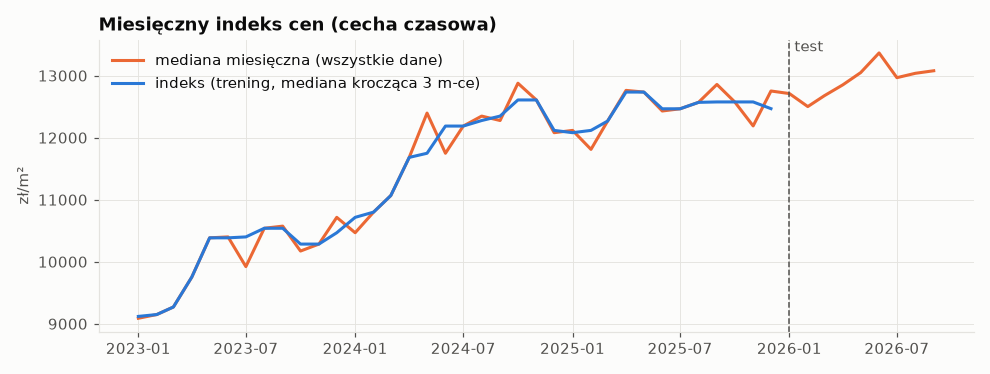
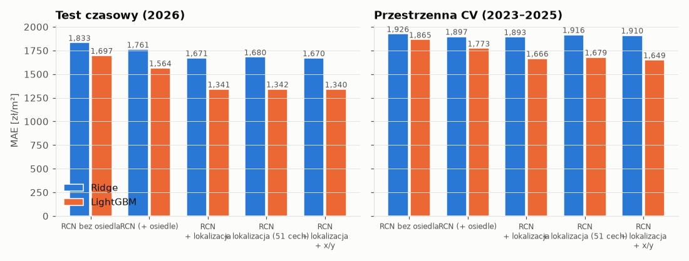

# Etap 4 – czyszczenie i modele

Wygenerowano: 2026-11-13 00:14.

## 1. Czyszczenie

| krok                                                |   przed |    po |   usunięte |
|:----------------------------------------------------|--------:|------:|-----------:|
| rekordy ms:lokale (TERYT 0264)                      |   62470 | 62470 |          0 |
| lokal mieszkalny                                    |   62470 | 50818 |      11652 |
| rodzaj transakcji: wolny rynek                      |   50818 | 47703 |       3115 |
| udział 1/1                                          |   47703 | 46771 |        932 |
| 1 lokal mieszkalny w transakcji                     |   46771 | 46633 |        138 |
| znany rynek (pierwotny/wtórny)                      |   46633 | 46633 |          0 |
| akt od 2023-01-01                                   |   46633 | 45402 |       1231 |
| powierzchnia 15–300 m²                              |   45402 | 45388 |         14 |
| znana cena/m² (lok_cena lub tran_cena dla 1 lokalu) |   45388 | 45295 |         93 |
| cena/m² 3,000–50,000 zł                             |   45295 | 45178 |        117 |
| obcięcie 0.5% ogonów ceny/m² w każdym roku          |   45178 | 44732 |        446 |
| duplikaty (lokal, data, cena)                       |   44732 | 44720 |         12 |

Wynik: **44,720 transakcji**, 2023-01 – 2026-09; rynek pierwotny 52.5%, flaga parkingu 4.6%.

Cena/m² = `lok_cena_brutto / lok_pow_uzyt`; gdy brak ceny lokalu – `tran_cena_brutto / lok_pow_uzyt` tylko dla transakcji z jednym rekordem lokalu.

## 2. Schemat walidacji

- **Test czasowy:** trening 2023-01 – 2025-12 (36,386), test od 2026-01 (8,334). Wczesne zatrzymanie LightGBM na ostatnich 3 miesiącach treningu, potem douczenie na całym treningu (liczba drzew × 1,1).
- **Przestrzenna CV:** 5 foldów GroupKFold po blokach 1×1 km, tylko okres treningowy (bez danych z przyszłości). Walidacja LightGBM: 15% bloków treningowych.
- **Indeks cen** liczony wyłącznie na danych treningowych danego podziału; dla miesięcy testowych przenoszona jest ostatnia znana wartość.
- Cel modeli: log(cena/m²); metryki liczone po powrocie do zł/m² (i zł dla ceny całkowitej = predykcja/m² × powierzchnia).

## 3. Warianty cech

| wariant | zawartość |
|:--|:--|
| RCN bez osiedla | powierzchnia, piętro, izby, pow./izbę, pom. przynależne, flaga parkingu, rynek, sprzedający, kupujący, miesiąc, indeks cen |
| RCN (+ osiedle) | jw. + osiedle (48 kategorii) – **wariant bazowy** |
| RCN + lokalizacja | jw. + 115 cech dostępności z etapu 3 (bez współrzędnych) |
| RCN + lokalizacja (51 cech) | jak wyżej, ale 1 promień (500 m) na rodzinę cech, odległości piesze zamiast prostych |
| RCN + lokalizacja + x/y | jw. + współrzędne (górna granica „czystej” lokalizacji) |

## 4. Wyniki

### Test czasowy 2026 (n = 8,334)

|                                             |       MAE |      RMSE |   MAPE |    R2 |   MAE_total |   MAPE_total |
|:--------------------------------------------|----------:|----------:|-------:|------:|------------:|-------------:|
| ('LightGBM', 'RCN bez osiedla')             | 1,696.507 | 2,314.086 | 12.912 | 0.290 |  94,728.665 |       12.912 |
| ('LightGBM', 'RCN (+ osiedle)')             | 1,563.880 | 2,176.103 | 11.643 | 0.372 |  84,948.066 |       11.643 |
| ('LightGBM', 'RCN + lokalizacja')           | 1,340.506 | 1,870.970 | 10.020 | 0.536 |  72,094.963 |       10.020 |
| ('LightGBM', 'RCN + lokalizacja (51 cech)') | 1,341.865 | 1,865.618 | 10.041 | 0.538 |  71,881.715 |       10.041 |
| ('LightGBM', 'RCN + lokalizacja + x/y')     | 1,339.699 | 1,866.190 | 10.023 | 0.538 |  72,110.807 |       10.023 |
| ('Ridge', 'RCN bez osiedla')                | 1,832.855 | 2,447.862 | 14.310 | 0.205 | 101,490.796 |       14.310 |
| ('Ridge', 'RCN (+ osiedle)')                | 1,760.608 | 2,355.385 | 13.808 | 0.264 |  96,521.570 |       13.808 |
| ('Ridge', 'RCN + lokalizacja')              | 1,670.566 | 2,248.771 | 12.960 | 0.329 |  91,373.598 |       12.960 |
| ('Ridge', 'RCN + lokalizacja (51 cech)')    | 1,680.297 | 2,264.645 | 13.065 | 0.320 |  91,591.426 |       13.065 |
| ('Ridge', 'RCN + lokalizacja + x/y')        | 1,669.957 | 2,248.163 | 12.956 | 0.329 |  91,342.613 |       12.956 |

### Przestrzenna CV (wyniki zbiorcze z 5 foldów) (n = 36,386)

|                                             |       MAE |      RMSE |   MAPE |    R2 |   MAE_total |   MAPE_total |
|:--------------------------------------------|----------:|----------:|-------:|------:|------------:|-------------:|
| ('LightGBM', 'RCN bez osiedla')             | 1,864.682 | 2,533.674 | 15.936 | 0.316 | 101,523.500 |       15.936 |
| ('LightGBM', 'RCN (+ osiedle)')             | 1,772.659 | 2,480.557 | 14.989 | 0.344 |  95,839.593 |       14.989 |
| ('LightGBM', 'RCN + lokalizacja')           | 1,665.912 | 2,318.663 | 13.969 | 0.427 |  90,142.955 |       13.969 |
| ('LightGBM', 'RCN + lokalizacja (51 cech)') | 1,678.530 | 2,338.837 | 14.088 | 0.417 |  90,689.412 |       14.088 |
| ('LightGBM', 'RCN + lokalizacja + x/y')     | 1,649.086 | 2,305.086 | 13.774 | 0.434 |  89,255.489 |       13.774 |
| ('Ridge', 'RCN bez osiedla')                | 1,925.693 | 2,581.757 | 16.488 | 0.289 | 105,216.642 |       16.488 |
| ('Ridge', 'RCN (+ osiedle)')                | 1,897.352 | 2,555.403 | 16.304 | 0.304 | 103,131.052 |       16.304 |
| ('Ridge', 'RCN + lokalizacja')              | 1,892.796 | 2,534.362 | 16.094 | 0.315 | 102,755.298 |       16.094 |
| ('Ridge', 'RCN + lokalizacja (51 cech)')    | 1,916.396 | 2,532.610 | 16.443 | 0.316 | 103,471.168 |       16.443 |
| ('Ridge', 'RCN + lokalizacja + x/y')        | 1,910.193 | 2,557.080 | 16.238 | 0.303 | 103,592.104 |       16.238 |

### Zysk z cech lokalizacyjnych (względem wariantu bazowego „RCN + osiedle”)

|                                                                          |   ΔMAE [zł/m²] |   ΔMAE [%] |    ΔR² |
|:-------------------------------------------------------------------------|---------------:|-----------:|-------:|
| ('spatial_cv', 'LightGBM', 'RCN + lokalizacja vs RCN (+ osiedle)')       |       -106.748 |     -6.022 |  0.083 |
| ('spatial_cv', 'LightGBM', 'RCN + lokalizacja + x/y vs RCN (+ osiedle)') |       -123.573 |     -6.971 |  0.090 |
| ('spatial_cv', 'LightGBM', 'RCN (+ osiedle) vs RCN bez osiedla')         |        -92.023 |     -4.935 |  0.028 |
| ('spatial_cv', 'Ridge', 'RCN + lokalizacja vs RCN (+ osiedle)')          |         -4.556 |     -0.240 |  0.011 |
| ('spatial_cv', 'Ridge', 'RCN + lokalizacja + x/y vs RCN (+ osiedle)')    |         12.841 |      0.677 | -0.001 |
| ('spatial_cv', 'Ridge', 'RCN (+ osiedle) vs RCN bez osiedla')            |        -28.341 |     -1.472 |  0.014 |
| ('temporal', 'LightGBM', 'RCN + lokalizacja vs RCN (+ osiedle)')         |       -223.374 |    -14.283 |  0.164 |
| ('temporal', 'LightGBM', 'RCN + lokalizacja + x/y vs RCN (+ osiedle)')   |       -224.181 |    -14.335 |  0.166 |
| ('temporal', 'LightGBM', 'RCN (+ osiedle) vs RCN bez osiedla')           |       -132.627 |     -7.818 |  0.082 |
| ('temporal', 'Ridge', 'RCN + lokalizacja vs RCN (+ osiedle)')            |        -90.042 |     -5.114 |  0.065 |
| ('temporal', 'Ridge', 'RCN + lokalizacja + x/y vs RCN (+ osiedle)')      |        -90.651 |     -5.149 |  0.065 |
| ('temporal', 'Ridge', 'RCN (+ osiedle) vs RCN bez osiedla')              |        -72.247 |     -3.942 |  0.059 |

MAE w poszczególnych foldach przestrzennych (rozrzut ≈ niepewność; pełne przedziały bootstrap w etapie 5):

|                                        |     0 |     1 |     2 |     3 |     4 |
|:---------------------------------------|------:|------:|------:|------:|------:|
| LightGBM / RCN (+ osiedle)             | 1,678 | 2,078 | 1,558 | 1,810 | 1,740 |
| LightGBM / RCN bez osiedla             | 1,908 | 2,036 | 1,619 | 1,930 | 1,831 |
| LightGBM / RCN + lokalizacja           | 1,632 | 1,856 | 1,516 | 1,625 | 1,700 |
| LightGBM / RCN + lokalizacja (51 cech) | 1,692 | 1,866 | 1,508 | 1,608 | 1,719 |
| LightGBM / RCN + lokalizacja + x/y     | 1,602 | 1,871 | 1,504 | 1,582 | 1,687 |
| Ridge / RCN (+ osiedle)                | 1,989 | 2,100 | 1,625 | 2,009 | 1,764 |
| Ridge / RCN bez osiedla                | 2,014 | 2,148 | 1,730 | 1,907 | 1,830 |
| Ridge / RCN + lokalizacja              | 1,779 | 2,120 | 1,877 | 1,812 | 1,876 |
| Ridge / RCN + lokalizacja (51 cech)    | 1,911 | 2,155 | 1,831 | 1,836 | 1,849 |
| Ridge / RCN + lokalizacja + x/y        | 1,795 | 2,148 | 1,908 | 1,816 | 1,884 |

## 5. Diagnostyka testu czasowego

Mediana błędu (predykcja − cena) wg miesiąca, LightGBM – ujemna = niedoszacowanie (efekt przeniesionego indeksu przy rosnących cenach):

| month   |   RCN (+ osiedle) |   RCN + lokalizacja |
|:--------|------------------:|--------------------:|
| 2026-01 |               -69 |                 -26 |
| 2026-02 |              -222 |                -151 |
| 2026-03 |              -558 |                -306 |
| 2026-04 |              -440 |                -421 |
| 2026-05 |              -452 |                -466 |
| 2026-06 |              -715 |                -663 |
| 2026-07 |              -573 |                -495 |
| 2026-08 |              -743 |                -604 |
| 2026-09 |              -685 |                -476 |

MAE / MAPE wg rynku (LightGBM):

| rynek     |   ('MAE', 'rcn') |   ('MAE', 'rcn_lok') |   ('MAPE', 'rcn') |   ('MAPE', 'rcn_lok') |
|:----------|-----------------:|---------------------:|------------------:|----------------------:|
| pierwotny |          1,389.5 |              1,317.4 |               9.8 |                   9.2 |
| wtórny    |          1,718.1 |              1,360.9 |              13.3 |                  10.7 |

**Lokalizacje widziane w treningu:** 54.7% transakcji testowych leży w punkcie (budynku), który miał transakcje w okresie treningowym. MAE wg tego podziału:

|                                  |   RCN (+ osiedle) |   RCN + lokalizacja |   ΔMAE % |       n |
|:---------------------------------|------------------:|--------------------:|---------:|--------:|
| ('nowa (niewidziana)', 'lgbm')   |           1,445.9 |             1,460.3 |      1.0 | 3,776.0 |
| ('nowa (niewidziana)', 'ridge')  |           1,593.8 |             1,642.1 |      3.0 | 3,776.0 |
| ('widziana w treningu', 'lgbm')  |           1,661.6 |             1,241.3 |    -25.3 | 4,558.0 |
| ('widziana w treningu', 'ridge') |           1,898.8 |             1,694.2 |    -10.8 | 4,558.0 |

## 6. Ważność cech (LightGBM, gain, test czasowy)

**RCN (+ osiedle)** – top 15 (% całkowitego gain):

| feature          |   udział |
|:-----------------|---------:|
| osiedle          |     36.2 |
| t_month          |     19.0 |
| lok_pow_uzyt     |     10.7 |
| lok_liczba_izb   |      8.7 |
| is_primary       |      5.5 |
| area_per_room    |      5.0 |
| lok_nr_kond      |      4.7 |
| price_index      |      4.2 |
| tran_sprzedajacy |      3.3 |
| lok_pow_przyn    |      1.7 |
| tran_kupujacy    |      0.9 |
| has_parking_note |      0.2 |
| has_pow_przyn    |      0.1 |

**RCN + lokalizacja** – top 15 (% całkowitego gain):

| feature            |   udział |
|:-------------------|---------:|
| osiedle            |     19.1 |
| t_month            |     13.9 |
| lok_pow_uzyt       |      8.0 |
| dist_water_m       |      3.9 |
| lok_liczba_izb     |      3.9 |
| walk_water_m       |      3.7 |
| is_primary         |      3.6 |
| walk_rynek_m       |      2.6 |
| area_per_room      |      1.5 |
| price_index        |      1.4 |
| lok_nr_kond        |      1.3 |
| tran_sprzedajacy   |      1.2 |
| dist_tram_stop_m   |      1.1 |
| walk_pharmacy_m    |      1.0 |
| dist_post_office_m |      0.9 |

SHAP i przedziały ufności – etap 5.
