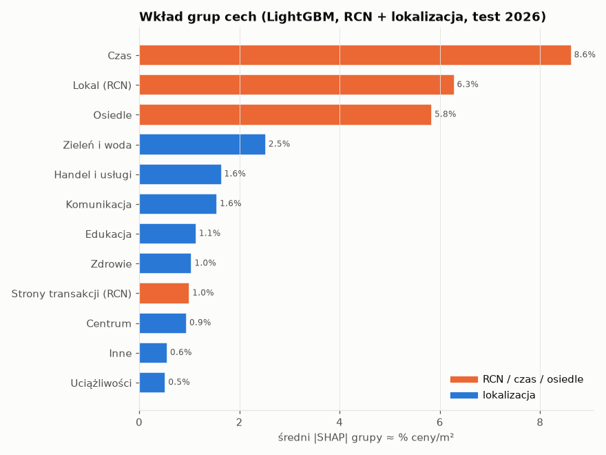
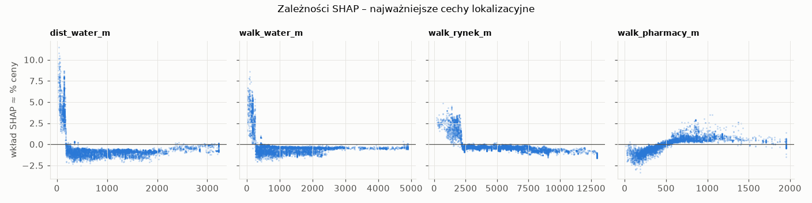
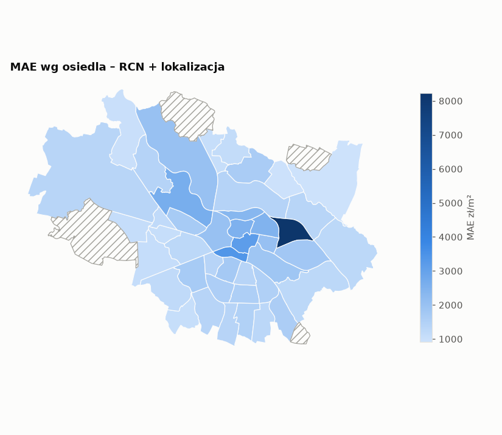
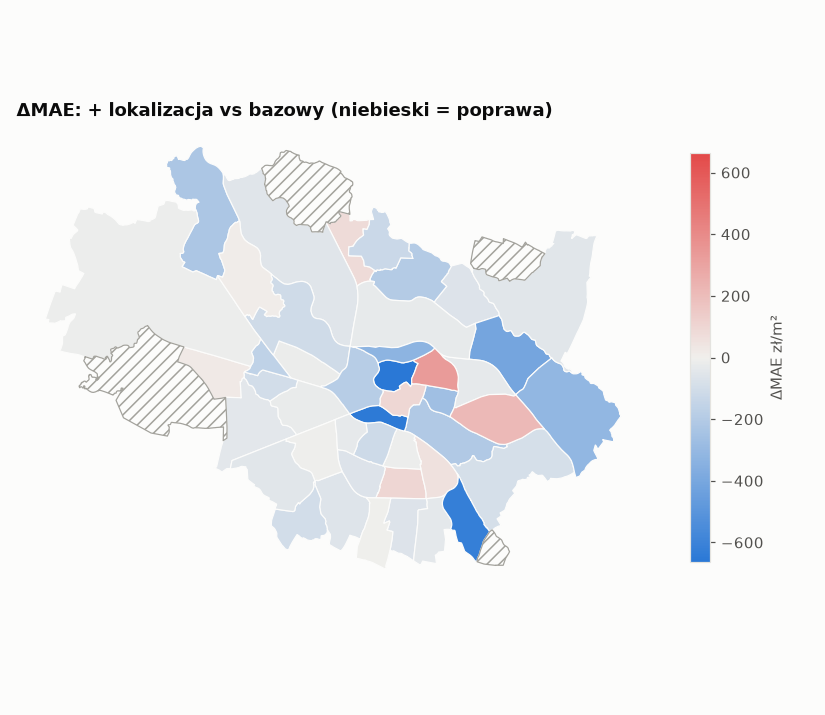

# Etap 5 – ewaluacja: przedziały ufności, SHAP, błędy przestrzenne

Wygenerowano: 2026-11-13 00:19.

## 1. Metoda

- **Sparowany bootstrap klastrowy** (2000 replikacji): losujemy całe klastry ze zwracaniem i liczymy metryki obu wariantów na tej samej próbie. Klaster = budynek (`location_id`) w teście czasowym, blok 1×1 km w przestrzennej CV (sprawdzająco również budynek). Transakcje z jednego budynku nie są niezależne – zwykły bootstrap zawyżyłby pewność.
- Przedział 95% percentylowy dla różnicy Δ = B − A; *p (B nie lepszy)* = odsetek replikacji, w których wariant B nie jest lepszy (jednostronny bootstrapowy p).
- **Nowe lokalizacje** = punkty (budynki) bez żadnej transakcji w okresie treningowym; to główna miara, czy cechy dostępności *uogólniają się*, a nie tylko identyfikują budynki.
- Skład testu 2026: nowe lokalizacje to 3,776 transakcji, w tym **76% rynek pierwotny** (lokalizacje z treningu: 23%). To głównie nowe inwestycje – inna populacja niż w przestrzennej CV.

## 2. Wyniki – MAE [zł/m²]

### LightGBM

|                                                                                           |   wartość A |   wartość B |   Δ (B−A) | 95% CI Δ     |   p (B nie lepszy) | n / klastry    |
|:------------------------------------------------------------------------------------------|------------:|------------:|----------:|:-------------|-------------------:|:---------------|
| ('test 2026 – wszystkie', 'RCN + lokalizacja vs RCN (+ osiedle)')                         |       1,564 |       1,341 |      -223 | [-329; -126] |              0     | 8,334 / 3,181  |
| ('test 2026 – wszystkie', 'RCN + lokalizacja (51 cech) vs RCN (+ osiedle)')               |       1,564 |       1,342 |      -222 | [-329; -118] |              0     | 8,334 / 3,181  |
| ('test 2026 – wszystkie', 'RCN + lokalizacja + x/y vs RCN + lokalizacja')                 |       1,341 |       1,340 |        -1 | [-21; 20]    |              0.467 | 8,334 / 3,181  |
| ('test 2026 – wszystkie', 'RCN (+ osiedle) vs RCN bez osiedla')                           |       1,697 |       1,564 |      -133 | [-225; -38]  |              0.003 | 8,334 / 3,181  |
| ('test 2026 – nowe lokalizacje', 'RCN + lokalizacja vs RCN (+ osiedle)')                  |       1,446 |       1,460 |       +14 | [-116; 162]  |              0.567 | 3,776 / 966    |
| ('test 2026 – nowe lokalizacje', 'RCN + lokalizacja (51 cech) vs RCN (+ osiedle)')        |       1,446 |       1,465 |       +19 | [-112; 162]  |              0.593 | 3,776 / 966    |
| ('test 2026 – nowe lokalizacje', 'RCN + lokalizacja + x/y vs RCN + lokalizacja')          |       1,460 |       1,459 |        -1 | [-50; 42]    |              0.462 | 3,776 / 966    |
| ('test 2026 – nowe lokalizacje', 'RCN (+ osiedle) vs RCN bez osiedla')                    |       1,440 |       1,446 |        +6 | [-163; 189]  |              0.521 | 3,776 / 966    |
| ('test 2026 – lokalizacje z treningu', 'RCN + lokalizacja vs RCN (+ osiedle)')            |       1,662 |       1,241 |      -420 | [-547; -330] |              0     | 4,558 / 2,215  |
| ('test 2026 – lokalizacje z treningu', 'RCN + lokalizacja (51 cech) vs RCN (+ osiedle)')  |       1,662 |       1,240 |      -422 | [-554; -329] |              0     | 4,558 / 2,215  |
| ('test 2026 – lokalizacje z treningu', 'RCN + lokalizacja + x/y vs RCN + lokalizacja')    |       1,241 |       1,241 |        -0 | [-9; 8]      |              0.461 | 4,558 / 2,215  |
| ('test 2026 – lokalizacje z treningu', 'RCN (+ osiedle) vs RCN bez osiedla')              |       1,909 |       1,662 |      -248 | [-333; -176] |              0     | 4,558 / 2,215  |
| ('przestrzenna CV', 'RCN + lokalizacja vs RCN (+ osiedle)')                               |       1,773 |       1,666 |      -107 | [-186; -25]  |              0.003 | 36,386 / 207   |
| ('przestrzenna CV', 'RCN + lokalizacja (51 cech) vs RCN (+ osiedle)')                     |       1,773 |       1,679 |       -94 | [-173; -14]  |              0.009 | 36,386 / 207   |
| ('przestrzenna CV', 'RCN + lokalizacja + x/y vs RCN + lokalizacja')                       |       1,666 |       1,649 |       -17 | [-38; 7]     |              0.07  | 36,386 / 207   |
| ('przestrzenna CV', 'RCN (+ osiedle) vs RCN bez osiedla')                                 |       1,865 |       1,773 |       -92 | [-196; 30]   |              0.069 | 36,386 / 207   |
| ('przestrzenna CV (klastry = budynki)', 'RCN + lokalizacja vs RCN (+ osiedle)')           |       1,773 |       1,666 |      -107 | [-161; -55]  |              0     | 36,386 / 7,354 |
| ('przestrzenna CV (klastry = budynki)', 'RCN + lokalizacja (51 cech) vs RCN (+ osiedle)') |       1,773 |       1,679 |       -94 | [-141; -47]  |              0     | 36,386 / 7,354 |
| ('przestrzenna CV (klastry = budynki)', 'RCN + lokalizacja + x/y vs RCN + lokalizacja')   |       1,666 |       1,649 |       -17 | [-30; -5]    |              0.004 | 36,386 / 7,354 |
| ('przestrzenna CV (klastry = budynki)', 'RCN (+ osiedle) vs RCN bez osiedla')             |       1,865 |       1,773 |       -92 | [-154; -33]  |              0.003 | 36,386 / 7,354 |
| ('test 2026 – indeks z trendem', 'RCN + lokalizacja vs RCN (+ osiedle)')                  |       1,531 |       1,336 |      -195 | [-302; -94]  |              0     | 8,334 / 3,181  |

### Ridge

|                                                                                           |   wartość A |   wartość B |   Δ (B−A) | 95% CI Δ     |   p (B nie lepszy) | n / klastry    |
|:------------------------------------------------------------------------------------------|------------:|------------:|----------:|:-------------|-------------------:|:---------------|
| ('test 2026 – wszystkie', 'RCN + lokalizacja vs RCN (+ osiedle)')                         |       1,761 |       1,671 |       -90 | [-157; -22]  |              0.005 | 8,334 / 3,181  |
| ('test 2026 – wszystkie', 'RCN + lokalizacja (51 cech) vs RCN (+ osiedle)')               |       1,761 |       1,680 |       -80 | [-149; -8]   |              0.017 | 8,334 / 3,181  |
| ('test 2026 – wszystkie', 'RCN + lokalizacja + x/y vs RCN + lokalizacja')                 |       1,671 |       1,670 |        -1 | [-1; 0]      |              0.051 | 8,334 / 3,181  |
| ('test 2026 – wszystkie', 'RCN (+ osiedle) vs RCN bez osiedla')                           |       1,833 |       1,761 |       -72 | [-151; 2]    |              0.029 | 8,334 / 3,181  |
| ('test 2026 – nowe lokalizacje', 'RCN + lokalizacja vs RCN (+ osiedle)')                  |       1,594 |       1,642 |       +48 | [-57; 156]   |              0.802 | 3,776 / 966    |
| ('test 2026 – nowe lokalizacje', 'RCN + lokalizacja (51 cech) vs RCN (+ osiedle)')        |       1,594 |       1,666 |       +72 | [-28; 196]   |              0.904 | 3,776 / 966    |
| ('test 2026 – nowe lokalizacje', 'RCN + lokalizacja + x/y vs RCN + lokalizacja')          |       1,642 |       1,641 |        -1 | [-3; 0]      |              0.042 | 3,776 / 966    |
| ('test 2026 – nowe lokalizacje', 'RCN (+ osiedle) vs RCN bez osiedla')                    |       1,590 |       1,594 |        +3 | [-123; 140]  |              0.531 | 3,776 / 966    |
| ('test 2026 – lokalizacje z treningu', 'RCN + lokalizacja vs RCN (+ osiedle)')            |       1,899 |       1,694 |      -205 | [-270; -137] |              0     | 4,558 / 2,215  |
| ('test 2026 – lokalizacje z treningu', 'RCN + lokalizacja (51 cech) vs RCN (+ osiedle)')  |       1,899 |       1,692 |      -207 | [-279; -142] |              0     | 4,558 / 2,215  |
| ('test 2026 – lokalizacje z treningu', 'RCN + lokalizacja + x/y vs RCN + lokalizacja')    |       1,694 |       1,694 |        -0 | [-1; 0]      |              0.308 | 4,558 / 2,215  |
| ('test 2026 – lokalizacje z treningu', 'RCN (+ osiedle) vs RCN bez osiedla')              |       2,034 |       1,899 |      -135 | [-236; -55]  |              0     | 4,558 / 2,215  |
| ('przestrzenna CV', 'RCN + lokalizacja vs RCN (+ osiedle)')                               |       1,897 |       1,893 |        -5 | [-137; 157]  |              0.463 | 36,386 / 207   |
| ('przestrzenna CV', 'RCN + lokalizacja (51 cech) vs RCN (+ osiedle)')                     |       1,897 |       1,916 |       +19 | [-84; 131]   |              0.624 | 36,386 / 207   |
| ('przestrzenna CV', 'RCN + lokalizacja + x/y vs RCN + lokalizacja')                       |       1,893 |       1,910 |       +17 | [7; 30]      |              1     | 36,386 / 207   |
| ('przestrzenna CV', 'RCN (+ osiedle) vs RCN bez osiedla')                                 |       1,926 |       1,897 |       -28 | [-129; 92]   |              0.304 | 36,386 / 207   |
| ('przestrzenna CV (klastry = budynki)', 'RCN + lokalizacja vs RCN (+ osiedle)')           |       1,897 |       1,893 |        -5 | [-103; 103]  |              0.423 | 36,386 / 7,354 |
| ('przestrzenna CV (klastry = budynki)', 'RCN + lokalizacja (51 cech) vs RCN (+ osiedle)') |       1,897 |       1,916 |       +19 | [-66; 102]   |              0.645 | 36,386 / 7,354 |
| ('przestrzenna CV (klastry = budynki)', 'RCN + lokalizacja + x/y vs RCN + lokalizacja')   |       1,893 |       1,910 |       +17 | [11; 24]     |              1     | 36,386 / 7,354 |
| ('przestrzenna CV (klastry = budynki)', 'RCN (+ osiedle) vs RCN bez osiedla')             |       1,926 |       1,897 |       -28 | [-80; 22]    |              0.136 | 36,386 / 7,354 |
| ('test 2026 – indeks z trendem', 'RCN + lokalizacja vs RCN (+ osiedle)')                  |       1,754 |       1,661 |       -92 | [-160; -23]  |              0.004 | 8,334 / 3,181  |

## 3. Wyniki – R² i MAPE (LightGBM, porównanie główne)

**R²**

|                                                                                 |   wartość A |   wartość B |   Δ (B−A) | 95% CI Δ        |   p (B nie lepszy) | n / klastry    |
|:--------------------------------------------------------------------------------|------------:|------------:|----------:|:----------------|-------------------:|:---------------|
| ('test 2026 – wszystkie', 'RCN + lokalizacja vs RCN (+ osiedle)')               |       0.372 |       0.536 |     0.164 | [0.083; 0.235]  |              0     | 8,334 / 3,181  |
| ('test 2026 – nowe lokalizacje', 'RCN + lokalizacja vs RCN (+ osiedle)')        |       0.395 |       0.343 |    -0.052 | [-0.170; 0.074] |              0.777 | 3,776 / 966    |
| ('test 2026 – lokalizacje z treningu', 'RCN + lokalizacja vs RCN (+ osiedle)')  |       0.349 |       0.647 |     0.298 | [0.247; 0.344]  |              0     | 4,558 / 2,215  |
| ('przestrzenna CV', 'RCN + lokalizacja vs RCN (+ osiedle)')                     |       0.344 |       0.427 |     0.083 | [0.021; 0.137]  |              0.003 | 36,386 / 207   |
| ('przestrzenna CV (klastry = budynki)', 'RCN + lokalizacja vs RCN (+ osiedle)') |       0.344 |       0.427 |     0.083 | [0.041; 0.124]  |              0     | 36,386 / 7,354 |
| ('test 2026 – indeks z trendem', 'RCN + lokalizacja vs RCN (+ osiedle)')        |       0.393 |       0.539 |     0.146 | [0.061; 0.220]  |              0.001 | 8,334 / 3,181  |

**MAPE [%]**

|                                                                                 |   wartość A |   wartość B |   Δ (B−A) | 95% CI Δ       |   p (B nie lepszy) | n / klastry    |
|:--------------------------------------------------------------------------------|------------:|------------:|----------:|:---------------|-------------------:|:---------------|
| ('test 2026 – wszystkie', 'RCN + lokalizacja vs RCN (+ osiedle)')               |       11.64 |       10.02 |     -1.62 | [-2.21; -1.03] |               0    | 8,334 / 3,181  |
| ('test 2026 – nowe lokalizacje', 'RCN + lokalizacja vs RCN (+ osiedle)')        |       11.21 |       10.94 |     -0.27 | [-1.15; 0.72]  |               0.27 | 3,776 / 966    |
| ('test 2026 – lokalizacje z treningu', 'RCN + lokalizacja vs RCN (+ osiedle)')  |       12.01 |        9.26 |     -2.75 | [-3.36; -2.24] |               0    | 4,558 / 2,215  |
| ('przestrzenna CV', 'RCN + lokalizacja vs RCN (+ osiedle)')                     |       14.99 |       13.97 |     -1.02 | [-1.74; -0.37] |               0    | 36,386 / 207   |
| ('przestrzenna CV (klastry = budynki)', 'RCN + lokalizacja vs RCN (+ osiedle)') |       14.99 |       13.97 |     -1.02 | [-1.37; -0.67] |               0    | 36,386 / 7,354 |
| ('test 2026 – indeks z trendem', 'RCN + lokalizacja vs RCN (+ osiedle)')        |       11.47 |       10    |     -1.47 | [-2.09; -0.85] |               0    | 8,334 / 3,181  |

## 4. SHAP – co model wykorzystuje (LightGBM, RCN + lokalizacja, test 2026)

Udział grup lokalizacyjnych w łącznym |SHAP|: **31.9%** (pozostałe: lokal, czas, osiedle, strony transakcji). Średni |SHAP| liczony po zsumowaniu wkładów cech w grupie, więc cechy znoszące się wzajemnie nie są zawyżane.

|                         |   mean_abs_shap |   share_% |   approx_%_price |
|:------------------------|----------------:|----------:|-----------------:|
| Czas                    |           0.083 |    26.759 |            8.622 |
| Lokal (RCN)             |           0.061 |    19.721 |            6.285 |
| Osiedle                 |           0.057 |    18.360 |            5.839 |
| Zieleń i woda           |           0.025 |     8.069 |            2.525 |
| Handel i usługi         |           0.016 |     5.266 |            1.641 |
| Komunikacja             |           0.015 |     4.989 |            1.554 |
| Edukacja                |           0.011 |     3.659 |            1.137 |
| Zdrowie                 |           0.010 |     3.376 |            1.049 |
| Strony transakcji (RCN) |           0.010 |     3.237 |            1.006 |
| Centrum                 |           0.009 |     3.049 |            0.947 |
| Inne                    |           0.006 |     1.817 |            0.563 |
| Uciążliwości            |           0.005 |     1.697 |            0.526 |

Top 20 pojedynczych cech:

|                  |   mean_abs_shap | grupa                   |   ≈ % ceny |
|:-----------------|----------------:|:------------------------|-----------:|
| t_month          |           0.071 | Czas                    |      7.411 |
| osiedle          |           0.057 | Osiedle                 |      5.839 |
| lok_pow_uzyt     |           0.042 | Lokal (RCN)             |      4.241 |
| is_primary       |           0.025 | Lokal (RCN)             |      2.540 |
| lok_liczba_izb   |           0.020 | Lokal (RCN)             |      1.993 |
| dist_water_m     |           0.014 | Zieleń i woda           |      1.433 |
| price_index      |           0.011 | Czas                    |      1.128 |
| walk_water_m     |           0.009 | Zieleń i woda           |      0.878 |
| lok_nr_kond      |           0.009 | Lokal (RCN)             |      0.873 |
| walk_rynek_m     |           0.007 | Centrum                 |      0.718 |
| walk_pharmacy_m  |           0.006 | Zdrowie                 |      0.614 |
| tran_sprzedajacy |           0.006 | Strony transakcji (RCN) |      0.606 |
| area_per_room    |           0.006 | Lokal (RCN)             |      0.575 |
| tran_kupujacy    |           0.006 | Strony transakcji (RCN) |      0.564 |
| walk_snap_m      |           0.006 | Inne                    |      0.563 |
| dist_tram_stop_m |           0.005 | Komunikacja             |      0.507 |
| walk_school_m    |           0.005 | Edukacja                |      0.474 |
| walk_stop_m      |           0.004 | Komunikacja             |      0.399 |
| walk_park_m      |           0.004 | Zieleń i woda           |      0.397 |
| walk_tram_stop_m |           0.004 | Komunikacja             |      0.364 |

## 5. Błędy w przestrzeni (przestrzenna CV, LightGBM)

Cechy lokalizacyjne zmniejszają MAE w **36 z 44** osiedli z ≥ 30 transakcjami (pozostałe kreskowane na mapach).

Największa poprawa / pogorszenie:

| osiedle                                   |     n |   MAE bazowy |   MAE + lokalizacja |    Δ |
|:------------------------------------------|------:|-------------:|--------------------:|-----:|
| Nadodrze                                  | 1,879 |        3,190 |               2,526 | -664 |
| Przedmieście Świdnickie                   |   777 |        4,043 |               3,390 | -653 |
| Brochów                                   |   545 |        2,238 |               1,612 | -626 |
| Kowale                                    |   158 |        1,771 |               1,356 | -415 |
| Kleczków                                  |   366 |        2,693 |               2,363 | -331 |
| Lipa Piotrowska                           |   836 |          998 |               1,079 |   81 |
| Stare Miasto                              |   606 |        3,068 |               3,164 |   96 |
| Gaj                                       |   684 |        1,445 |               1,548 |  103 |
| Biskupin - Sępolno - Dąbie - Bartoszowice |   548 |        1,594 |               1,807 |  213 |
| Ołbin                                     | 1,649 |        2,128 |               2,465 |  337 |
